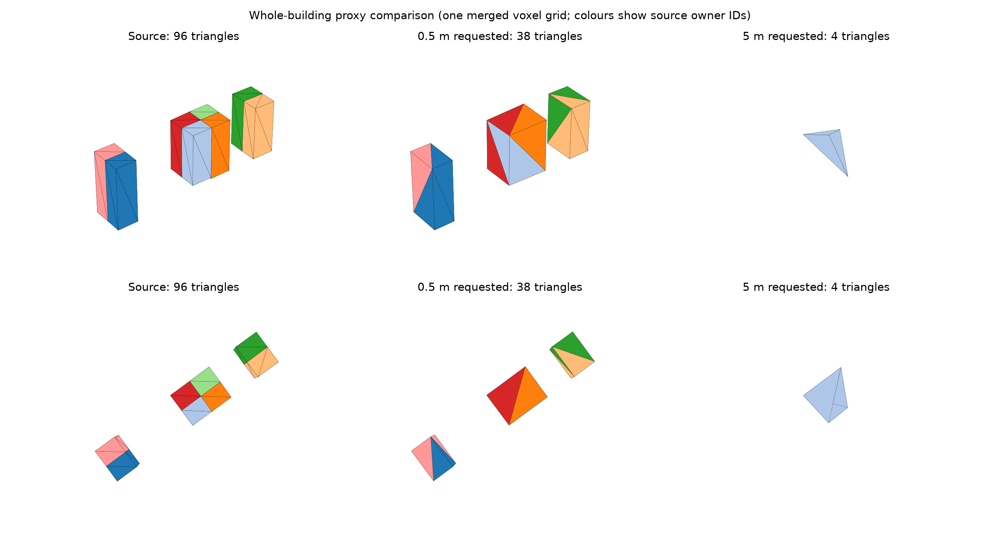

# Voxel remeshing evaluation

The tables below describe the original resolution-based implementation at commit
`b412366`, before the rectangular voxel-size API. They remain a comparison baseline;
the current implementation has no 256-resolution clamping. Updated measurements
are in [rectangular grid evaluation](rectangular-voxel-grid-evaluation.md).

Evaluated on 2026-10-11 with the release `cjconvert` and vendored meshoptimizer
v1.3. Inputs are whole objects from `/home/ravi/sync/tyler-lods/CitySJON-Gebouwen`,
selected at LoD 2.2. No geometry was clipped. Default flat normals, quantization,
meshopt compression, and all source attribute rows were retained.

The implementation substantially reduces geometry, but its reported error is
insufficient for assigning 3D Tiles `geometricError` directly. In particular,
isolated objects can disappear during remeshing/simplification. Their distance
to the remaining proxy can exceed the estimate by hundreds of metres.

## Export measurements

Each row is one local run, with wall time and child-process peak RSS. Results
include parsing, LoD selection, triangulation, remeshing, attribution, metadata,
and GLB writing. Times are indicative rather than a performance guarantee.
MB uses decimal units; RSS uses MiB. An asterisk marks resolution clamping.

| Dataset suffix | Requested m | Triangles | GLB MB | Seconds | Peak RSS MiB | Resolution | Estimated error m |
|---|---:|---:|---:|---:|---:|---:|---:|
| 110000_492000 | source | 3,526 | 0.075 | 0.013 | 17.0 | — | — |
| 110000_492000 | 5 | 410 | 0.037 | 0.034 | 33.5 | 256* | 17.266 |
| 110000_492000 | 20 | 74 | 0.030 | 0.033 | 34.0 | 256* | 24.664 |
| 110000_492000 | 40 | 26 | 0.029 | 0.020 | 23.2 | 180 | 40.680 |
| 174000_440000 | source | 39,229 | 0.692 | 0.084 | 43.2 | — | — |
| 174000_440000 | 5 | 2,508 | 0.220 | 0.120 | 59.2 | 256* | 17.052 |
| 174000_440000 | 20 | 224 | 0.171 | 0.117 | 58.9 | 256* | 24.408 |
| 174000_440000 | 40 | 26 | 0.167 | 0.099 | 57.4 | 178 | 40.590 |
| 120000_484000 | source | 775,314 | 13.802 | 1.636 | 576.0 | — | — |
| 120000_484000 | 5 | 34,760 | 3.502 | 2.313 | 814.9 | 256* | 18.685 |
| 120000_484000 | 20 | 8,648 | 2.942 | 2.601 | 814.3 | 256* | 26.218 |
| 120000_484000 | 40 | 1,598 | 2.778 | 2.152 | 804.1 | 198 | 40.736 |

The largest sample's 20 m export reduces triangles by 98.9% and total bytes by
78.7%. Retained attributes create a size floor: further geometry reduction from
20 m to 40 m saves relatively few total bytes.

Example reproduction commands from the repository root:

```sh
cargo build --release -p cityjson-convert --bin cjconvert
target/release/cjconvert \
  /home/ravi/sync/tyler-lods/CitySJON-Gebouwen/buildings_2025_120000_484000.city.json \
  --lod 2.2 --output /tmp/source.glb
target/release/cjconvert \
  /home/ravi/sync/tyler-lods/CitySJON-Gebouwen/buildings_2025_120000_484000.city.json \
  --lod 2.2 --remesh-error 20 --output /tmp/proxy.glb
```

## Sampled surface distances

For each direction, 1,024 area-weighted points were sampled on triangle interiors
with NumPy `default_rng(271828)`. Distances were measured to the nearest triangle
of the other mesh using a BVH and exact point-to-triangle distance. Both meshes
were decoded from the actual quantized/compressed GLBs, including their node
transforms. The reference is the selected source GLB, not the original CityJSON
before encoding. Samples include internal interfaces between touching buildings.
These sampled maxima are observations, not certified Hausdorff bounds.

| Dataset suffix | Requested m | Source → proxy max / RMS m | Proxy → source max / RMS m | Represented owners / retained rows |
|---|---:|---:|---:|---:|
| 110000_492000 | 5 | 11.173 / 1.468 | 6.492 / 0.785 | 39 / 47 |
| 110000_492000 | 20 | 892.797 / 82.470 | 9.737 / 2.708 | 11 / 47 |
| 110000_492000 | 40 | 1958.373 / 567.887 | 11.466 / 4.977 | 5 / 47 |
| 174000_440000 | 5 | 147.976 / 4.879 | 7.980 / 1.621 | 492 / 630 |
| 174000_440000 | 20 | 716.867 / 117.497 | 11.987 / 2.650 | 100 / 630 |
| 174000_440000 | 40 | 2273.345 / 606.296 | 20.070 / 5.039 | 16 / 630 |
| 120000_484000 | 5 | 8.335 / 2.380 | 7.566 / 1.970 | 9032 / 11297 |
| 120000_484000 | 20 | 78.899 / 6.021 | 11.910 / 2.608 | 4729 / 11297 |
| 120000_484000 | 40 | 112.324 / 12.997 | 18.584 / 3.831 | 1017 / 11297 |

Every decoded output triangle had one feature ID across all three corners, with
IDs inside the declared range. Source and proxy metadata row counts matched.
An owner missing from the output does not alone prove its geometry disappeared:
nearest-triangle attribution is approximate around merged surfaces. Large
source-to-proxy distances establish actual geometric loss.

## Whole-object visual checks

Two subsets were also exported, retaining complete building families:

- Eight nearby families from `174000_440000`, chosen by the smallest eighth-neighbour
  centre distance, contain 96 source triangles. At 0.5 m the proxy has 38 triangles,
  all eight owners, and a 1.120 m estimate; sampled maxima are 1.700 m forward and
  0.070 m reverse. Shared internal interfaces disappear. At 5 m only four triangles
  remain, with two owners and a 10.440 m forward sampled maximum.
- Eight families nearest the first sorted building with LoD 2.2 in
  `110000_492000` contain 943 triangles over a sparse, wide area. At 2 m the grid
  clamps and yields 202 triangles, all eight owners, and a 4.295 m forward sampled
  maximum. At 10 m, seven owners remain and the forward sampled maximum reaches
  892.942 m. The prominent roof silhouette survives while roof detail is reduced;
  one distant small building disappears.

The figure shows the dense subset from the same oblique and overhead cameras.
Colours indicate approximate source owners. The coarse result makes the loss
visible even though the simplifier's reported error remains small.



This evaluation checks categorical IDs and static geometry, including winding
through positive signed volume on inspected closed meshes. It does not exercise
interactive picking in a 3D Tiles viewer. The automated GLB checks also cover
nearby and separated objects, flat/smooth normals, raw/quantized/compressed
encodings, accessor bounds, and clipping rejection.

## Consequences for parent tiles

The current report is useful for grid selection and diagnostics. Parent tiles
need a validated error that accounts for lost components and source coverage,
followed by monotonic error propagation (`parent >= children`) and `REPLACE`
refinement. Options worth evaluating next are preservation of disconnected
components during simplification, or a conservative surface-distance validation
stage. Smaller groups of whole objects help avoid grid clamping, but do not
eliminate the component-loss problem.

There is also an existing precision limitation: source-coordinate export casts
world coordinates to float before recentering. The report includes a deliberately
generous rounding allowance (about 0.7–0.8 m on these RD-coordinate exports).
Moving recentering before that cast is a separate improvement; Tyler's local ENU
placement can keep coordinate magnitudes smaller.

Full measurements are in [performance JSON](voxel-remeshing-performance.json)
and [distance JSON](voxel-remeshing-distances.json). RSS for the dense subset in the
raw JSON includes the NumPy launcher footprint and is not comparable to the
full-file export measurements.

Input SHA-256 checksums:

```text
110000_492000 b2051c695eba5a7a283e04d9f15eec55d9aa12f3a9d2de7f34aa66318932874f
174000_440000 ccaea72da912b8452e1a352ad954c1f1e26a032f53302d3fb3316ce018d715dd
120000_484000 0584b4470858d6ca2acc27ed842aec0e2d7d7fc4bfe4724032b3145f38e7f955
```
